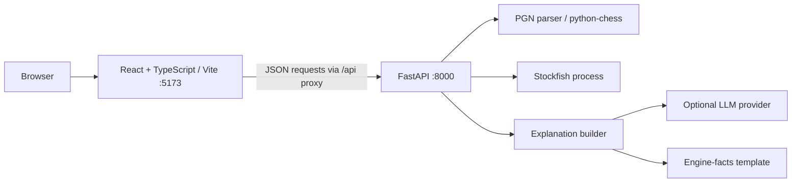

# Architecture

This document describes the application in the `integration` branch at checkpoint `9a7dfce`.

## Components

Stockfish produces chess evaluations and lines. The LLM explains supplied facts; it is not the source of move legality or position scores.

## Frontend

| Source in `integration` | Responsibility |
| --- | --- |
| `src/main.tsx` | Application shell and local practice board |
| `src/Review.tsx` | PGN upload, selected ply, review, and explanation display |
| `src/api.ts` | HTTP requests, API types, error messages, and evaluation formatting |
| `src/analysis.ts` | Local demonstration hints for the practice board |
| `src/style.css` | Layout, responsive styles, and chessboard appearance |
| `vite.config.ts` | Fixed development port and `/api` proxy |

The review board displays the position after the selected ply. Ply 0 is the starting position. It does not let users alter the uploaded game. A separate practice board uses chess.js for legal moves and automatically promotes pawns to queens.

Request generation identifiers prevent an explanation for an older selection from replacing the result for a newer selection. Game-wide analysis can continue while the user selects another move.

## Backend

| Source in `integration` | Responsibility |
| --- | --- |
| `backend/app/main.py` | Routes, application lifetime, game storage, and caches |
| `backend/app/schemas.py` | Pydantic request and response models |
| `backend/app/pgn.py` | Parse the first PGN game and record each move's positions |
| `backend/app/engine.py` | Manage Stockfish and normalize evaluations |
| `backend/app/analysis.py` | Per-move evaluation loss, classification, and critical moments |
| `backend/app/coach/explain.py` | Build engine facts and produce an explanation or fallback |
| `backend/app/coach/llm.py` | Isolate communication with the provider SDK |
| `backend/app/config.py` | Read environment configuration |

One long-lived Stockfish process is protected by a lock. Synchronous API handlers run in FastAPI worker threads. This is a local MVP, not a multi-user scaling design.

## Review flow

1. `POST /api/games` parses PGN and returns a game ID, headers, and FEN positions.
2. `POST /api/games/{id}/analyze` evaluates the game's positions and returns classifications.
3. Selecting a move updates the displayed board and facts.
4. `POST /api/explain` reuses or creates the analysis, obtains deeper engine lines, and requests an explanation.
5. If the LLM is unavailable, the same endpoint returns a template and `llm_used: false`.

The explanation's first best line is kept consistent with the best move reported in the analysis table, including when the played move itself was best.

## Evaluation semantics

- Scores are always from White's point of view. Board rotation does not change their sign.
- One pawn equals 100 centipawns.
- Mate scores use a separate signed `mate` field; `mate: 0` means the current position is checkmate.
- `cp_loss` measures loss for the player who moved and is nonnegative.
- The backend clamps evaluations to +/-1000 centipawns when calculating loss; it is not always the raw difference between the displayed scores.

## Persistence and boundaries

Games and analysis caches live in server memory. Restarting the backend clears them. There are no accounts, database, durable uploads, or deployment configuration for a public service.

The Vite proxy is a development feature. A production frontend build alone does not provide `/api`; deployment would need a separately configured backend and routing.
